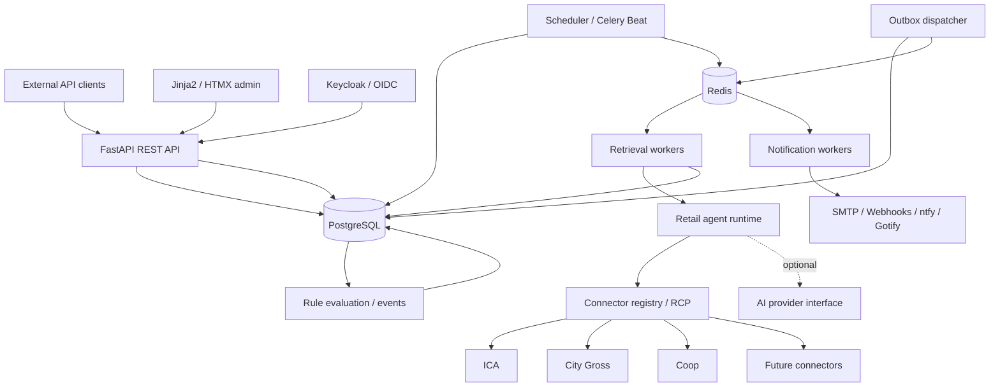
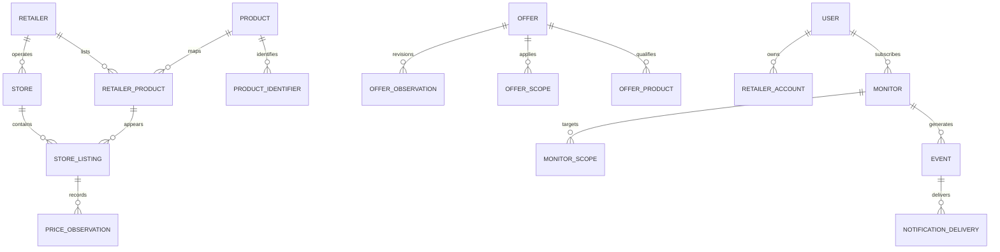

# Price Watch

> Self-hosted retail discovery, price history and promotion monitoring service.

**Specification:** v1.0 | **Status:** implementation in progress; City Gross, Coop, Willys, Dollarstore and Lidl (link-only) live connectors working, ICA blocked | **Initial market:** Sweden (SE)

The code currently implements invitation-based users, scoped client credentials with per-user grants, a fixture-backed store, basic catalogue/prices/offers, three public monitor types, database-backed jobs, signed webhook delivery, an admin page for setup and management, an example client (`/demo`, usable on a phone, with a camera barcode scanner) and a Docker image. It does **not** yet meet the full MVP checklist below, and five retailers have live retrieval (ICA is blocked). See the [access policy](#access-policy) and [Implementation status](docs/implementation-status.md) for setup and remaining work, and the [API guide](docs/api.md) to build an app on the service (served at `/api-guide`; example client at `/demo`).

## 1. Purpose

Price Watch is an always-on, API-first FastAPI service for individuals and households. It acts as a read-only shopping agent, discovering products by name or barcode, collecting prices and promotions, and notifying subscribers when relevant changes are observed. It initially targets ICA, City Gross and Coop, with a reusable connector protocol for additional retailers and countries. External applications such as Crisis Planner consume its API; they are not dependencies.

### Scope and agreed requirements

- Personal and household use, with separate users, household permissions and retailer accounts.
- Online and physical store prices, explicitly distinguished; unpublished physical prices remain unknown.
- On-demand discovery and a growing shared catalogue, not bulk catalogue harvesting.
- REST API plus an administration interface; no full consumer frontend required.
- Exact product, generic purchasing requirement, general store and personal offer monitoring.
- General store subscriptions detect **all newly published accessible promotions**, not just watched products; optional filters and digests.
- Hybrid YAML/Python retailer connectors; optional AI assistance through local or external providers.
- Webhooks, SMTP email, self-hosted push (ntfy, optionally Gotify).
- Anonymous and authenticated browsing, including user-mediated login where required.
- Historical observations, source provenance, freshness and reliable event deduplication.
- Docker Compose deployment on an always-on home server; compatible with Unraid (a ready single-file setup is in [deploy/unraid/](deploy/unraid/README.md)), Keycloak and Nginx Proxy Manager.

### Non-goals

Purchasing, cart modification, coupon activation, account changes, payment handling, checkout automation, access-control bypass, guaranteed coverage of unpublished offers, guaranteed first-in-market alerts, and commercial-scale harvesting are out of scope. 
### Access policy

*Owner decision, 2026-11-26.* Price Watch is a private, single-household tool. It retrieves what a normal visitor can see on a retailer's public website (and, later, what the owner's own retailer account can see), automated on the owner's behalf. Two limits define that scope:

- **Targeted, not bulk.** It searches for and monitors specific products the owner chose. It does not crawl or harvest a retailer's catalogue, categories or full offer lists.
- **No circumvention.** It requests pages at human-scale volume and does not defeat CAPTCHAs, bot detection, rate limits or login controls, and it does not disguise what it is. If a site refuses the client, the connector stops, reports `access_blocked` and stays paused until the owner reviews it.

A per-retailer terms review is therefore not a gate for enabling a connector; the owner is responsible for their own use.

## 2. Architecture

Use a modular monolith with separate worker processes. PostgreSQL is authoritative; Redis is a disposable queue broker, not the only copy of schedules or events.



### Technology choices

| Layer | Technology |
|---|---|
| Runtime | Python 3.12+; pin a tested version |
| API | FastAPI, Pydantic v2, Uvicorn |
| Persistence | PostgreSQL, SQLAlchemy 2, Alembic |
| Background | Celery, Redis, Celery Beat |
| Retrieval | HTTPX, Playwright Chromium, lxml/BeautifulSoup |
| Leaflets | PyMuPDF; Tesseract only when text extraction is inadequate |
| Administration | Jinja2, HTMX |
| Authentication | OIDC/Keycloak, scoped API client tokens |
| AI | Ollama, OpenAI, Anthropic, configurable compatible endpoint, disabled mode |
| Quality | pytest, Ruff, mypy, recorded fixtures |
| Operations | Docker Compose, structured JSON logs, Prometheus-compatible metrics |

Use async database sessions in API handlers; Celery tasks may wrap async connector execution in an explicitly managed event loop. Never reuse an async client or browser across incompatible event loops or forked processes.

## 3. Repository layout

This is the target layout. The current code is flatter (`app/main.py`, `app/models.py`, `app/monitoring.py`, `app/worker.py`), but connectors already follow it: one folder per connector in [`connectors/`](connectors/README.md) at the repository root (or installed from the admin page), described in [docs/connectors.md](docs/connectors.md).

```text
retail-monitor/
├── app/
│   ├── main.py
│   ├── api/v1/
│   ├── core/                 # configuration, errors, logging, security
│   ├── auth/
│   ├── database/             # models, sessions, repositories
│   ├── catalogue/
│   ├── retailers/
│   ├── pricing/
│   ├── offers/
│   ├── matching/
│   ├── monitoring/           # exact, generic, store, personal rules
│   ├── events/               # evaluation, outbox, deduplication
│   ├── accounts/
│   ├── agents/               # browser/HTTP runtime and execution context
│   ├── connectors/
│   │   ├── base.py
│   │   ├── registry.py
│   │   ├── schemas.py
│   │   ├── shared/
│   │   └── se/
│   │       ├── ica/
│   │       ├── citygross/
│   │       └── coop/
│   ├── ai/providers/
│   ├── notifications/providers/
│   ├── jobs/                 # Celery app, tasks, leases, dispatch
│   ├── scheduler/
│   └── admin/                # routes, templates, static assets
├── migrations/
├── tests/{unit,integration,connectors,fixtures}/
├── config/
├── docs/
├── Dockerfile
├── docker-compose.yml
├── pyproject.toml
├── .env.example
└── README.md
```

## 4. Domain model and data conventions

A canonical product is a specific trade item; a retailer product is the retailer's SKU; a listing is that SKU in a store/channel context. An offer is a conditional commercial proposition, not necessarily a product price. A monitor is a user's subscription, not a retrieval job.

- IDs: UUIDs internally; retailer IDs are stable namespaced strings (e.g. `se.ica`). External store/SKU identifiers are strings, preserving leading zeroes.
- Monetary values: PostgreSQL NUMERIC and Python Decimal; JSON decimal strings; ISO 4217 currency codes. No binary float arithmetic for money.
- Timestamps: UTC timezone-aware; retailer validity dates interpreted using store timezone (Europe/Stockholm initially). Store source precision and inclusive/exclusive boundary semantics; do not invent times when only dates are known.
- Quantities: explicit units and net package contents; normalise compatible units to kg, L or count. Keep raw labels. Do not convert weight to volume without a verified conversion.
- GTIN: accept GTIN-8/12/13/14, validate check digit, normalise for matching to GTIN-14 while preserving original text. Never fabricate missing barcodes.
- Locale: ISO country code, locale, timezone, currency, number parsing and translations configurable by market. Swedish decimal commas, nonbreaking spaces and terms such as `kr`, `jfr-pris`, `medlemspris`, `st` handled in Swedish helpers.
- Unknown data is null/unknown, not zero, false or unavailable. Confidence is an extraction/matching indicator, not a calibrated probability unless validated.

## 5. Retailer Connector Protocol (RCP)

RCP is an internal versioned interface. Core services must not contain retailer-specific selectors, URL routes or login rules. Connectors are trusted, reviewed Python modules; never execute arbitrary user-uploaded code.

### Connector package

Each retailer package contains `manifest.yaml`, `connector.py`, `selectors.yaml`, optional navigation/auth/extraction modules and fixtures/tests. Registry discovers explicitly enabled packages at startup, validates manifest and protocol compatibility, and exposes capabilities. New retailer packages require no core changes unless the protocol itself needs extension.

Example manifest (illustrative; not verified against ICA):

```yaml
id: se.ica
name: ICA
country: SE
currency: SEK
locale: sv-SE
timezone: Europe/Stockholm
protocol_version: 1
connector_version: 0.1.0
enabled: false
capabilities:
  store_discovery: unverified
  product_search: unverified
  barcode_search: unverified
  online_prices: unverified
  physical_store_prices: unverified
  store_offers: unverified
  member_offers: unverified
  personal_offers: unverified
transport:
  primary: browser
  engine: chromium
allowed_hosts: [] # populate only after access review
rate_limits:
  concurrent_sessions: 1
  minimum_request_interval_seconds: 10 # proposed, not retailer-approved
monitoring:
  product_prices_minutes: 60
  store_offers_minutes: 60
  personal_offers_minutes: 180
```

Capabilities have states `supported`, `unsupported`, `unverified`; only verified supported operations are scheduled in production. Track access-review status separately from technical capability.

### Typed interface sketch

The following is an implementation contract, not runnable code. DTOs should be Pydantic models with generated JSON schemas. All operations return typed results with explicit coverage/status, not raw HTML.

```python
from typing import Protocol

class RetailerConnector(Protocol):
    async def discover_stores(self, ctx: Context) -> Result[StorePage]: ...
    async def select_store(self, ctx: Context) -> Result[StoreContext]: ...
    async def search_products(self, ctx: Context, query: SearchQuery) -> Result[ProductPage]: ...
    async def search_barcode(self, ctx: Context, gtin: str) -> Result[ProductPage]: ...
    async def get_product(self, ctx: Context, sku: str) -> Result[RetailerProduct]: ...
    async def get_prices(self, ctx: Context, skus: list[str]) -> Result[PriceBatch]: ...
    async def get_store_offers(self, ctx: Context) -> Result[OfferPage]: ...
    async def get_personal_offers(self, ctx: Context) -> Result[OfferPage]: ...
    async def get_availability(self, ctx: Context, sku: str) -> Result[Availability]: ...
    async def authenticate(self, ctx: Context) -> Result[AuthState]: ...
    async def validate_session(self, ctx: Context) -> Result[AuthState]: ...
    async def health_check(self, ctx: Context) -> Result[Health]: ...
```

`Context` contains connector ID/version, country, locale, timezone, store external ID, sales channel, account reference (nullable), request/job ID, deadline, pagination cursor where applicable, and injected restricted HTTP/browser clients. Secrets are supplied by the session manager, not serialized into queue payloads. `Result[T]` contains status, data, errors, source references, observation timestamp, completeness (`complete`, `partial`, `unknown`), next cursor, and optional retry-after. Batch results include per-item status. A selected store must be verified from the source before attributing prices to it.

### Standard result statuses

`success`, `partial`, `not_found`, `unavailable`, `unsupported`, `auth_required`, `rate_limited`, `access_blocked`, `extraction_failed`, `network_error`, `timeout`, `invalid_data`.

Staleness is a property of cached data, not a successful connector result. A failed search is not proof of a discontinued product. `unavailable` requires explicit source evidence. Partial snapshots cannot establish offer absence.

### Retrieval policy

Prefer official APIs or authorised feeds, then permitted structured website data/HTTP extraction, browser automation, leaflet parsing, and optional AI-assisted extraction. Do not bypass CAPTCHA, BankID, rate limits, access controls or retailer restrictions. Browser sessions represent the user's authorised account from the home server; they do not impersonate a different network/device identity or guarantee the same view as the user's local browser.

Use bounded navigation timeouts, host allowlists, TLS verification, rate limiting per retailer and account, and redacted diagnostics. Validate every redirect and outbound request destination, including subresources where practicable. Restrict browser egress at network level; avoid private/internal networks except explicit trusted services. Never execute instructions embedded in pages or leaflets.

### Connector onboarding

1. Record the access decision and date (see [Access policy](#access-policy)); confirm retrieval stays targeted to monitored products.
2. Identify store selection, channels, product search, SKU/GTIN availability and offer sources.
3. Capture sanitised fixtures and create normalisers and parsers.
4. Verify store context, currencies, price/offer semantics and pagination completeness.
5. Test anonymous access first, then authenticated access if permitted.
6. Configure conservative rate limits and health checks; enable only verified capabilities.
7. Run regression tests and a low-volume authorised smoke test; release a versioned connector.

## 6. Retail agent runtime

A retail agent is a deterministic executor, not necessarily an LLM. Workflow: claim job → resolve connector and scope → establish store/account context → retrieve → validate → normalise → persist → evaluate monitors → enqueue notifications.

- Reuse anonymous contexts only within compatible store/channel scopes; never leak selected-store state between jobs.
- Isolate authenticated browser contexts per account; serialize access to mutable account sessions.
- Prefer HTTP where permitted and sufficient; use Playwright for JS-dependent flows.
- Capture source URL, retrieval time, connector version, and optional redacted evidence hash/snippet. Screenshots/HTML are short-lived, restricted diagnostics, not public catalogue data.
- Apply per-host rate limits across workers, bounded concurrency, timeouts and jitter. Honor Retry-After. On blocked access stop and require review; on layout failures trip a circuit breaker.
- Check pagination and snapshot completeness. Detect missing expected fields, invalid currency, contradictory store context and suspicious values; quarantine rather than publish doubtful observations.

## 7. Catalogue and matching

Search cached catalogue first, optionally launch live search across selected stores. Persist discovered listings and verified attributes; use retailer SKU links for later direct retrieval. Results indicate source, age, match confidence and partial coverage.

Matching priority: verified GTIN → existing verified mapping → exact brand/name/variant/package quantity → fuzzy matching → optional AI proposal → manual review. Ambiguous results remain separate provisional products. Never merge distinct flavours, formulations, pack sizes or multipacks solely by text similarity. Use aliases for Swedish and other locale variants. Track mapping provenance and review history; allow correction without losing price observations.

Barcode lookup uses the shared GTIN index even if a retailer cannot search by barcode. If no verified mapping exists, return unknown or candidates; optional permitted external product metadata can help find a name but cannot establish retailer stock or price. Store-wide offer scans may create provisional catalogue entries; basket/category offers need not reference a specific SKU.

Generic product requirements are structured filters (query, categories, brands, excluded terms, package min/max, unit-price limit, optional attributes). Generic requirements are not canonical products. Unknown attributes do not satisfy strict filters; AI matches are suggestions unless validated.

## 8. Prices and offers

### Price observation contract

```json
{
  "retailer_id": "se.ica",
  "store_id": "example-store-uuid",
  "retailer_sku": "example-sku",
  "sales_channel": "online",
  "eligibility": "public",
  "account_id": null,
  "currency": "SEK",
  "regular_price": "29.95",
  "current_price": "24.95",
  "unit_price": {"amount": "16.63", "unit": "kg"},
  "package_quantity": {"value": "1.5", "unit": "kg"},
  "availability": "in_stock",
  "observed_at": "2026-11-26T09:00:00Z",
  "source_url": "https://example.invalid/product",
  "connector_version": "0.1.0",
  "confidence": 1.0
}
```

Examples throughout are synthetic. Channel enum: `online`, `physical`, `unknown`; never infer physical price from online data. Eligibility: `public`, `member`, `personal`, `unknown`; keep distinct price series. If membership tiers or fulfilment methods affect price, include them in scope. Record retailer-stated regular/reference price separately from observed historical minimum. Keep deposits, delivery charges and other fees separate where known; comparisons must disclose their basis.

Unit price = eligible price / net package quantity in a compatible base unit; use decimal precision and documented rounding. Multibuy effective unit price applies only when required quantity and eligibility are satisfied. Do not assign a basket discount to an individual SKU without an explicit allocation model.

### Offer contract

Support fixed promotional price, fixed/percentage discount, multibuy, BOGO, mix-and-match, member/personal price, coupon, basket discount and clearance. Model offer mechanics separately from eligibility so, for example, a member-only multibuy can be represented.

Fields: offer ID, retailer external ID (nullable), title, raw terms, mechanics, eligibility/account, currency, discount or price, required quantity, qualifying product/group references, applicable stores/channels, start/end and precision, purchase limits, activation requirement, source URLs, observed timestamp, status and completeness. Unknown dates or terms remain unknown. Preserve original Swedish terms for auditing.

Offer identity: use stable retailer promotion IDs within scope where available; otherwise derive a versioned fingerprint from retailer, scope, qualifying items/groups, mechanics and campaign identity. Do not treat changing price/terms alone as a new identity when a stable campaign can be identified. Maintain a separate content hash for revisions. Cross-source matching must be conservative; uncertain duplicates can be reviewed. Repeated campaigns with distinct validity periods are distinct instances.

Offer states: `upcoming`, `active`, `expired`, `withdrawn`, `unknown`. Explicit end date can establish expiry; missing from a complete authoritative snapshot may establish withdrawal after a configurable confirmation policy. Partial/failed scans cannot withdraw offers. Notify newly discovered upcoming offers with validity dates rather than describing them as active.

## 9. Monitoring engine

Four monitor types share the same scheduler, retrieval planner, rule evaluator and event infrastructure.

| Type | Target | Default intent |
|---|---|---|
| `exact_product` | GTIN, canonical ID or retailer listing | Price changes, offers, thresholds |
| `generic_product` | Structured search criteria | New matches and qualifying prices/offers |
| `store` | One or more individual stores | Every new published accessible promotion |
| `personal_offers` | Specific authenticated account/store scope | New or changed private offers |

Monitor configuration: owner, optional household, name, type, retailer/store/country scope, channel, eligibility, account (where applicable), conditions, triggers, requested interval, enabled/paused status, first-scan policy, notification destinations, immediate/digest mode and quiet hours. Persist effective interval, last attempt, last successful check and next due time. Require explicit store scope or a saved store preference when prices are store-specific; do not silently choose a store.

### Store-wide monitoring

Under the [access policy](#access-policy), live connectors do not scan a store's whole offer list. `store` monitors apply only to connectors that expose a bounded offers feed (today, only the fixture connector). For live retailers the target is that exact and generic monitors also report promotions attached to the products they match.

Store monitoring is first-class and independent of individual watched products. Check published weekly offers, digital leaflets, campaign pages, online promotions, membership offers and clearance listings when accessible. Default to all categories with no product filter. Optional filters: keywords, categories, excluded categories, minimum discount, maximum price, offer type, membership eligibility and channel.

On first complete successful scan establish a baseline, unless `notify_existing_offers=true`. Subsequent scans detect new promotions and revisions across all supported sources. Preserve per-source coverage and report unavailable sources; never claim all physical promotions are known. Partial initial scans must not falsely establish complete coverage. Personal offers may be included only through an explicitly authorised account scope; never mix private data into shared snapshots.

### Event semantics

| Event | Trigger |
|---|---|
| `price.increased`, `price.decreased` | Change between comparable validated observations |
| `price.threshold_reached` | Transition from nonqualifying to qualifying; configurable first observation |
| `price.historical_low` | New low in a defined observed history window |
| `offer.detected` | Previously unseen campaign in scope |
| `offer.changed` | Material revision of a known campaign |
| `offer.expiring` | Configured lead time before known expiry |
| `offer.expired` | Confirmed expiry |
| `product.discovered` | New matching product for a generic monitor |
| `product.restocked`, `product.unavailable` | Explicit availability transition |
| `account.session_expired` | Authentication required |
| `connector.failed` | Operational failure/circuit breaker; rate-limited alert |

Compare only identical store/channel/eligibility/account/currency contexts. Threshold alerts fire on crossing, not every observation below threshold; rearm when condition becomes false. Baseline policy is explicit. Persist rule evaluation state. Deduplicate event identity by monitor, subject, event type and transition/revision ID; deduplicate user delivery across overlapping product/store subscriptions while retaining all matching monitor IDs. A repeated unchanged observation must not produce an alert.

### Default intervals (proposed)

| Operation | Interval |
|---|---|
| Exact product and generic monitoring | 60 min |
| General store offers | 60 min |
| Personal offers | 180 min |
| Connector health | 60 min |
| Store directory | 7 days |
| Live search | On demand |

These defaults are configurable and must be clamped to verified retailer limits. Alerts are sent promptly after detection, not necessarily immediately after publication. Hourly polling can miss short-lived offers or changes between scans.

## 10. Persistence and database design

Use Alembic migrations, foreign keys, explicit constraints and transactions. UUID primary keys unless noted. All mutable records have created/updated timestamps. Observations are append-only; corrections carry provenance. Never store private offers in a public scope.

| Table | Principal fields and constraints |
|---|---|
| users | id, oidc_issuer, oidc_subject; unique issuer/subject |
| households | id, name, owner_id |
| household_members | household_id, user_id, role; unique pair |
| api_clients | id, owner_id, household_id, token_hash, scopes, expires_at, revoked_at |
| countries | ISO code PK, currency, locale, timezone defaults |
| retailers | namespaced ID PK, country, name, enabled |
| stores | id, retailer_id, external_id, name, address, timezone, capabilities; unique retailer/external_id |
| connectors / connector_versions | retailer, protocol version, release version, manifest, review status |
| retailer_accounts | owner_id, retailer_id, label, status, consent/scope |
| retailer_sessions | account_id, encrypted state, key version, expiry, last_validated_at |
| products | brand, name, variant, package quantity/unit, match status |
| product_identifiers | product_id, type, normalized value, source, verified; verified GTIN unique |
| product_categories | localized label, parent_id; product-category association |
| retailer_products | retailer_id, external_sku, product_id nullable, raw attributes, URL; unique retailer/SKU |
| store_listings | retailer_product_id, store_id nullable, channel, fulfilment context; unique normalized scope |
| price_observations | listing_id, eligibility, account_id nullable, currency, regular/current price, unit price, availability, observed_at, source, run_id |
| offers | retailer_id, identity key, eligibility, account_id, status, first_seen, last_seen; unique identity within scope |
| offer_scopes | offer_id, store_id nullable, channel, region/campaign scope |
| offer_products | offer_id, retailer_product_id nullable, qualifying group, quantity constraints |
| offer_observations | offer_id, content hash, normalized mechanics/terms, validity, source, run_id, observed_at |
| watchlists | owner_id, household_id nullable, name |
| monitors | owner_id, household_id, watchlist_id nullable, type, conditions JSONB, interval, state, next_due_at |
| monitor_scopes | monitor_id, store/retailer/account references, channel, eligibility |
| monitor_conditions / evaluation_state | monitor_id, subject/scope key, criteria/state, last transition; unique state key |
| jobs | kind, canonical scope hash, state, due_at, lease_until, attempt count, result reference |
| job_runs / connector_runs | job_id, connector version, start/end, result status, coverage, redacted error |
| events | owner_id, monitor_id, subject, type, transition_id, payload, created_at; unique event key |
| outbox | event/job reference, payload, available_at, dispatch status, attempts |
| notification_channels | owner_id, provider, encrypted config, enabled |
| notification_deliveries | event/group ID, channel_id, idempotency key, status, attempts, next_attempt; unique delivery key |
| audit_logs | actor, action, target, timestamp, redacted metadata |

Store account-specific rows with a mandatory account reference and enforce owner authorization on every query. For nullable scope fields, use explicit normalized keys or PostgreSQL NULLS NOT DISTINCT constraints to prevent duplicate logical identities. Index GTIN, retailer SKU, store, due jobs, next monitor due time, event creation time and price history by listing/eligibility/account/currency/time. Use PostgreSQL full-text search and optional pg_trgm for catalogue search. Introduce time partitioning only if measured volume warrants it.



## 11. Scheduling, execution and recovery

Celery Beat triggers a periodic due-work scan, rather than being the authoritative per-monitor scheduler. PostgreSQL stores due times and job leases. Use `SELECT ... FOR UPDATE SKIP LOCKED` or equivalent transactional claiming. Advance due times transactionally with job creation/outbox insertion. On restart recover overdue schedules, expired leases and undispatched outbox rows. Avoid replaying every missed poll; catch up once and preserve gaps in observation history.

Canonical retrieval keys include connector, operation, store, sales channel, normalized query/SKU batch, eligibility and account where required. Share compatible public retrievals across subscribers; never coalesce different private accounts. Batch price requests where supported. Keep on-demand searches higher priority than periodic polling with fairness and shared rate limits.

Job states: `queued`, `running`, `succeeded`, `partial`, `retry_wait`, `failed`, `cancelled`. Use bounded leases/heartbeats, task time limits, exponential backoff with jitter, and finite retries. Authentication required, access blocked and unsupported operations are not transient retries. Repeated extraction failures pause connector operations until review. Redis loss must not lose durable work: reconcile queued/leased jobs against PostgreSQL. At-least-once execution is expected; writes and events must be idempotent using run/observation keys and unique constraints.

Persist validated observations, evaluation work and outbox records atomically. Evaluate rules against ordered observations with concurrency control so old or duplicate jobs cannot reverse latest state. The outbox dispatcher publishes jobs/events after commit; reconcile undispatched messages. Notifications use separate workers and retry policies. Exactly-once delivery cannot be guaranteed for external SMTP/HTTP providers; stable IDs and delivery records minimize duplication.

## 12. REST API

Base path `/v1`. JSON, OpenAPI, bearer tokens, explicit scopes. Use cursor pagination for large lists; default 50, bounded maximum 200 (proposed). Return ISO timestamps and decimal strings. Never expose private account data through public catalogue queries.

| Method | Path | Purpose |
|---|---|---|
| GET | /countries | Supported markets |
| GET | /retailers | Retailers and capabilities |
| GET | /retailers/{id}/stores | Store discovery/cache |
| GET | /stores/{id} | Store details |
| GET | /stores/{id}/offers | Current store offers |
| GET | /stores/{id}/offers/history | Offer history |
| GET | /products/search | Cached search by query/GTIN |
| POST | /search/jobs | Live search |
| GET | /products/barcode/{gtin} | Verified barcode lookup |
| GET | /products/{id} | Canonical product |
| GET | /products/{id}/prices | Latest contextual prices |
| GET | /products/{id}/history | Price history |
| GET | /products/{id}/offers | Applicable promotions |
| GET | /offers | Filtered offers |
| GET | /offers/{id} | Offer details |
| POST, GET | /watchlists | Create/list watchlists |
| GET, PATCH, DELETE | /watchlists/{id} | Manage watchlist |
| POST, GET | /monitors | Create/list monitors |
| GET, PATCH, DELETE | /monitors/{id} | Manage subscription |
| POST | /monitors/{id}/check | Immediate check |
| GET | /monitors/{id}/events | Monitor events |
| POST, GET | /retailer-accounts | Connect/list accounts |
| POST | /retailer-accounts/{id}/authenticate | Initiate interactive login |
| GET | /retailer-accounts/{id}/offers | Private offers |
| DELETE | /retailer-accounts/{id} | Revoke/remove session |
| POST, GET | /notification-channels | Configure/list channels |
| PATCH, DELETE | /notification-channels/{id} | Manage channel |
| POST, GET | /webhooks | Register/list webhook destinations |
| GET | /events | User-visible event feed |
| GET | /jobs/{id} | Job state, result, coverage |
| GET | /connectors | Connector capabilities |
| GET | /connectors/{id}/health | Connector health |
| GET | /health/live, /health/ready | Liveness/readiness (outside /v1) |

Admin-only routes under `/admin` and `/v1/admin` for connector enable/pause, diagnostics, mapping review, job management, configuration and users. Do not permit arbitrary URL fetching or arbitrary code execution via admin configuration.

### Request examples

```http
GET /v1/products/search?q=havregryn&country=SE
GET /v1/products/barcode/7310000000000
GET /v1/stores/{store_id}/offers?status=active
```

Barcode above is illustrative and must pass validation before use. For live search:

```json
{
  "query": "havregryn",
  "country": "SE",
  "store_ids": ["<store_uuid>"],
  "sales_channels": ["online", "physical"]
}
```

`POST /v1/search/jobs` returns HTTP 202 with `{ "job_id": "<uuid>", "status": "queued", "status_url": "/v1/jobs/<uuid>" }`. Use a query or GTIN (at least one), bounded search fan-out, and return partial results explicitly. Cached responses contain `items`, `next_cursor`, `as_of`, `last_successful_check`, `stale`, and coverage metadata where applicable. Distinguish unsupported from no matching results.

### Store monitor example

`POST /v1/monitors`

```json
{
  "name": "Local supermarket promotions",
  "type": "store",
  "scope": {
    "country": "SE",
    "store_ids": ["<ica_store_uuid>", "<citygross_store_uuid>", "<coop_store_uuid>"],
    "sales_channels": ["physical", "online"]
  },
  "conditions": {},
  "triggers": ["offer.detected", "offer.changed"],
  "check_interval_minutes": 60,
  "notify_existing_offers": false,
  "notifications": {"mode": "immediate", "channel_ids": ["<ntfy_channel_uuid>"]},
  "enabled": true
}
```

### Generic monitor example

```json
{
  "name": "Affordable brown rice",
  "type": "generic_product",
  "scope": {"country": "SE", "store_ids": ["<store_uuid>"], "sales_channels": ["online", "physical"]},
  "conditions": {
    "query": "råris",
    "minimum_package_weight_kg": "1",
    "maximum_unit_price": {"amount": "25.00", "currency": "SEK", "unit": "kg"}
  },
  "triggers": ["price.threshold_reached", "offer.detected", "product.discovered"],
  "check_interval_minutes": 60,
  "enabled": true
}
```

Exact monitor conditions reference a verified product ID, GTIN or retailer listing. Personal monitor scopes reference a retailer account owned by the caller. Validate type-specific conditions with discriminated Pydantic unions; reject unsupported combinations. Use idempotency keys for create/check requests, scoped to caller and request body. Return 201 for resource creation, 202 for queued work, 400/422 for invalid requests, 401/403 for auth failures, 404 for inaccessible or missing resources, 409 for conflicts, 429 for throttling. Error envelope: `code`, `message`, `details` (safe), `request_id`, optional `retry_after`. Version breaking schema changes under a new API version.

## 13. Notifications

Provider interface: `validate_config`, `send(event, destination, delivery_id)`, `health_check`. Provider results distinguish accepted, retryable failure and permanent failure. Implement signed webhooks, SMTP, ntfy; Gotify optional. Support immediate alerts, scheduled digests, timezone-aware quiet hours, delivery preferences and history. For a store scan, group new offers into a single notification with count and links/details; retain individual events in API feed.

```json
{
  "event_id": "<uuid>",
  "type": "offer.detected",
  "occurred_at": "2026-11-26T09:00:00Z",
  "monitor_ids": ["<uuid>"],
  "retailer_id": "se.ica",
  "store_id": "<uuid>",
  "data": {"offer_id": "<uuid>", "title": "Example promotion", "sales_channel": "physical"}
}
```

Webhook signing: HMAC-SHA256 over timestamp plus exact raw body, versioned signature header, stable event/delivery ID; receivers verify signature, timestamp and deduplicate. Require HTTPS by default. Protect against SSRF with destination validation, DNS/IP checks, redirect restrictions and egress controls. Allow explicit administrator-approved private destinations for home-server integrations. No secrets in logs. Retry network/429/5xx with bounded backoff; handle permanent errors separately; expose dead-letter failures and manual retry. Never send private offer details to a destination that is not authorized for the account.

## 14. Authentication and privacy

OIDC via existing Keycloak: validate issuer, audience, signature, expiry and scopes. Admin browser flow uses authorization code with PKCE, secure HttpOnly cookies and CSRF protection. API clients use scoped revocable credentials or OIDC service accounts. Suggested scopes: `catalogue:read`, `monitors:read/write`, `accounts:manage`, `events:read`, `notifications:manage`, `admin`. Enforce resource ownership in addition to token scopes. Household sharing is opt-in; personal retailer accounts remain owner-private by default.

Retailer login is distinct from service login. Initiate an isolated, time-limited interactive browser session from admin UI using an authenticated remote browser channel (implementation choice pending). The user completes login/MFA/BankID manually. Persist encrypted Playwright storage state or approved session material; avoid passwords where possible. Revalidate before private retrieval; when expired, pause account-dependent jobs and notify owner. Revoke/delete local session state on disconnect; explain that retailer-side revocation may require user action. No automation of BankID approval or CAPTCHA circumvention.

Encrypt secrets using authenticated encryption with a key outside database/backups, key IDs and rotation support. Restrict file permissions. Never send credentials, cookies, personal identifiers or authenticated page content to external AI providers without explicit data-sharing design/consent. Use sanitised fixtures, short diagnostic retention, user export/deletion, and encrypted backups. Run containers non-root; isolate browser sandbox and network; limit CPU/memory and file access. Restrict admin interface to LAN/VPN or authenticated reverse proxy. No database/Redis public ports.

## 15. AI provider framework

AI is optional, disabled by default. Provide a typed provider interface for structured extraction, candidate matching and diagnostic suggestions, with adapters for Ollama, OpenAI, Anthropic and compatible APIs. Configuration: endpoint, model, secret reference, timeout, token budget, permitted tasks and data policy. Use bounded retries and validated structured outputs. Page content is untrusted, never instructions; AI cannot invoke arbitrary browser actions, change connectors or approve authentication. Require source evidence for prices/offers, deterministic validation and human review of connector repairs before tests/deployment. If AI unavailable, standard deterministic operations continue; AI-dependent jobs report degraded coverage.

## 16. Administration and analytics

Jinja2/HTMX admin pages: dashboard (connector health, queue, overdue jobs, active monitors, coverage), retailers/stores, catalogue/mapping review, prices/history, offers, monitoring editor, retailer account connection, notification destinations, AI provider settings, jobs/diagnostics, users/households, audit logs. Require authorization and CSRF for mutations. Use pagination and avoid loading large raw artifacts.

Analytics: current/previous price, lowest observed 30/90/365-day price, average/median (declare sampling or time-weighting), historical trend, promotion frequency, unit-price comparison and cheapest eligible alternative. Show observation window, gaps, counts, store/channel/eligibility and freshness. Do not equate observed 30-day low with a legally required retailer reference price. Predictive analytics deferred until sufficient data is available.

## 17. Deployment and operations

Proposed containers: `retail-api`, `retail-worker`, `retail-scheduler`, `retail-notifier`, `retail-postgres`, `retail-redis`; outbox dispatcher can run in scheduler or separate process. Existing Keycloak/Nginx Proxy Manager remain external. Optional local Ollama is separate. Starting estimate: 4 CPU cores, 4–8 GB RAM excluding local AI, 20 GB storage, two browser workers. Benchmark before increasing concurrency.

Compose implementation target (illustrative scaffold, not runnable until application/Dockerfile and settings exist):

```yaml
services:
  api:
    build: .
    command: uvicorn app.main:app --host 0.0.0.0 --port 8000
    env_file: .env
    ports: ["127.0.0.1:8085:8000"]
    restart: unless-stopped
  worker:
    build: .
    command: celery -A app.jobs.celery_app worker -Q retrieval --concurrency=2
    env_file: .env
    restart: unless-stopped
  scheduler:
    build: .
    command: celery -A app.jobs.celery_app beat
    env_file: .env
    restart: unless-stopped
  notifier:
    build: .
    command: celery -A app.jobs.celery_app worker -Q notifications,maintenance --concurrency=1
    env_file: .env
    restart: unless-stopped
  postgres:
    image: postgres:17
    environment:
      POSTGRES_DB: retail
      POSTGRES_USER: retail
      POSTGRES_PASSWORD: ${POSTGRES_PASSWORD:?required}
    volumes: ["postgres_data:/var/lib/postgresql/data"]
    restart: unless-stopped
  redis:
    image: redis:7
    restart: unless-stopped
volumes:
  postgres_data:
```

Production Compose must add health checks, migration/init coordination, secret mounts, explicit networks, browser sandbox dependencies, resource limits, and persistence for encrypted session artifacts if not in DB. Pin tested image digests. If Nginx Proxy Manager is a separate container, connect API to an approved shared proxy network instead of assuming loopback is reachable. Redis and PostgreSQL should reside on an isolated network. Avoid running browser processes as root or disabling sandbox protections.

Example configuration keys: `DATABASE_URL`, `CELERY_BROKER_URL`, `OIDC_ISSUER`, `OIDC_AUDIENCE`, `OIDC_CLIENT_ID`, `SESSION_ENCRYPTION_KEY_FILE`, `SMTP_HOST`, `NTFY_BASE_URL`, `AI_PROVIDER=disabled`, `LOG_LEVEL`, `DIAGNOSTIC_RETENTION_DAYS`, `DEFAULT_TIMEZONE=Europe/Stockholm`. Keep real values in secret storage, not Git. Use individual least-privilege service credentials where practical.

Planned setup commands (after implementation):

```sh
cp .env.example .env
# Configure secrets, OIDC, network and retailer access settings.
docker compose build
docker compose up -d postgres redis
docker compose run --rm api alembic upgrade head
docker compose up -d
docker compose logs -f api worker
```

Readiness checks DB connectivity and schema version; liveness checks process health. Connector failures degrade connector status, not whole-service liveness. Structured logs include request/job/run IDs, connector, duration and result (redacted). Metrics: queue depth, overdue monitors, retrieval duration/success, last successful scan, stale coverage, rate limits, notification failures, DB growth. Alert on scheduler heartbeat loss and persistent failures. Daily encrypted backups, proposed 30-day retention, regular restore tests; include database, configuration and separately protected key recovery material. Keep historical observations by configurable retention policy (initially indefinite subject to storage/privacy); diagnostics default 7 days. Restore must reconcile jobs and preserve deduplication state.

## 18. Testing and acceptance

Unit tests: GTIN/check digits, Swedish price parsing, units/rounding, matching, offer fingerprint/revisions, rule transitions, scope and privacy validation. Connector fixture tests: store selection, pagination, public/member/personal prices, multibuy, leaflets, missing fields, layout changes and partial scans. Integration tests: PostgreSQL migrations/constraints, API auth, job retries/leases, outbox and notification dedup, session isolation. End-to-end tests use synthetic retailer fixtures by default; authorized live smoke tests are opt-in and low volume. Security tests cover ownership bypass, SSRF, credential leakage, untrusted page content and webhook signatures.

### MVP checklist

- [ ] Docker deployment and restart recovery work.
- [ ] Discover and select stores with verified context.
- [ ] Search by name and verified barcode mapping; grow shared catalogue.
- [ ] Public ICA, City Gross and Coop connectors support verified accessible operations.
- [ ] Preserve online/physical channel distinction and unknown prices.
- [ ] Exact and generic monitoring, including thresholds and new matching products.
- [ ] Store-wide monitoring detects new/changed promotions without individual watchlists.
- [ ] First scan baseline and optional existing-offer notification work.
- [ ] Duplicate sources, repeated scans and overlapping subscriptions do not spam users.
- [ ] Failed/partial scans do not generate false expiry, price or stock transitions.
- [ ] History and freshness/coverage available through API.
- [ ] Webhooks, email and ntfy deliver with retry/history.
- [ ] Admin UI manages stores, monitors, connectors and jobs.
- [ ] A fixture-based fourth retailer can be added without core changes.
- [ ] Backup/restore and authorization isolation tested.

Post-MVP acceptance: interactive retailer login and account-specific session isolation; personal-offer monitoring; AI provider adapters and reviewed repair workflow; external integration and international connector tests. These features remain in full scope, not discarded.

## 19. Implementation sequence

1. Repository, CI, settings, FastAPI, database migrations, OIDC and Compose.
2. RCP DTOs, registry, shared runtime, rate limiting and fixture connector.
3. ICA proof of concept: permitted store discovery, search, price and store offer retrieval; establish real coverage and permissions before enabling.
4. Catalogue matching, observations, offer lifecycle and public monitoring; scheduler/outbox/notification pipeline and administration UI.
5. City Gross and Coop connectors; test reusable contracts and refine without retailer-specific core logic.
6. Authenticated retailer sessions and personal offers (implement fourth monitor type fully).
7. Optional AI providers, leaflet extraction improvements and reviewed connector repair suggestions.
8. External API integration, international expansion, analytics and operational hardening.

## 20. Outstanding decisions and limitations

The original design baseline preceded implementation. The current fixture-backed code and migration checks are described at the top of this README and in [Implementation status](docs/implementation-status.md). ICA, City Gross and Coop support must be established empirically and within permitted access conditions. Physical-store prices, retailer barcode search, unpublished clearance, authentication/session persistence and complete offer coverage remain uncertain. No guaranteed alert latency or comprehensive physical-store coverage is possible from polling online sources alone.

Engineering defaults added by this specification: Jinja2/HTMX; Keycloak compatibility; household permissions; UUIDs; PostgreSQL-backed leases/outbox; hourly public polling; three-hour private polling; first scan baseline; public monitoring before private/AI features; resource estimates and retention defaults. These may be adjusted during implementation. Interactive remote-browser login transport, precise connector selectors, retailer endpoints, final dependency versions and measured rate limits are deliberately not invented. Compose and protocol snippets are implementation sketches, not finished runnable files.

## 21. References

Technical implementation references (official documentation; versions to be verified when building):

- [FastAPI](https://fastapi.tiangolo.com/)
- [Playwright Python](https://playwright.dev/python/) and [authentication](https://playwright.dev/python/docs/auth)
- [Celery](https://docs.celeryq.dev/)
- [PostgreSQL](https://www.postgresql.org/docs/)
- [SQLAlchemy](https://docs.sqlalchemy.org/)
- [Alembic](https://alembic.sqlalchemy.org/)
- [GS1 GTIN](https://www.gs1.org/standards/id-keys/gtin)
- [Keycloak](https://www.keycloak.org/documentation)
- [HTMX](https://htmx.org/docs/)
- [Ollama](https://docs.ollama.com/)
- [ntfy](https://docs.ntfy.sh/)
- [Docker Compose](https://docs.docker.com/compose/)
- Retailer starting points: [ICA](https://www.ica.se/), [City Gross](https://www.citygross.se/), [Coop](https://www.coop.se/). These are not verified automation endpoints.
